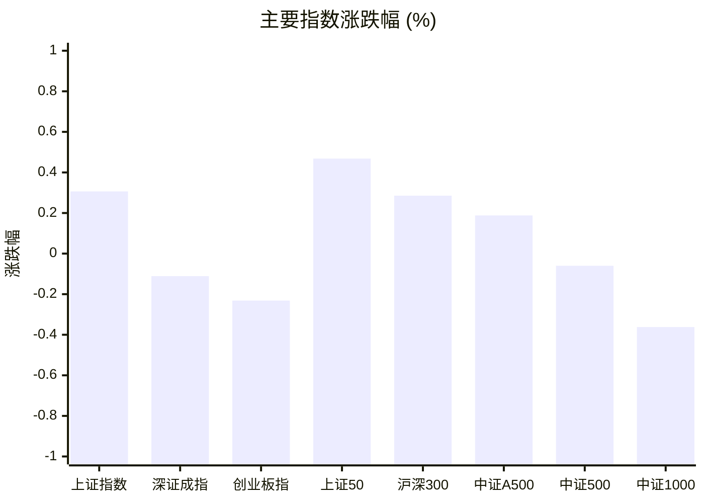
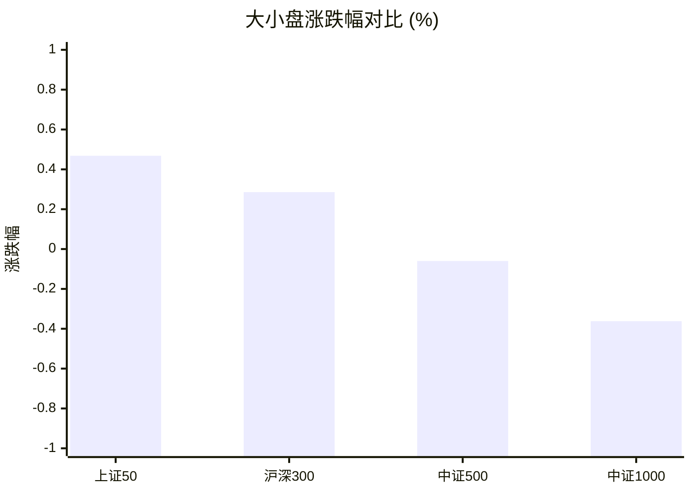
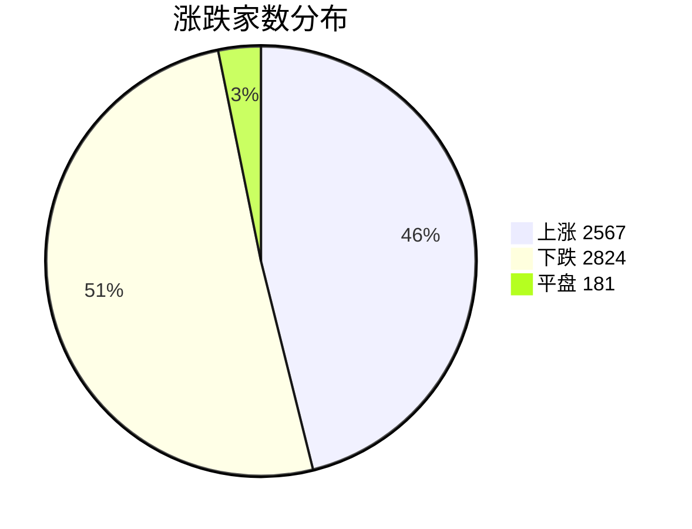
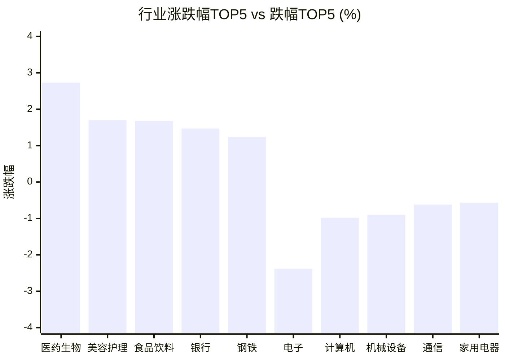

# 📊 A股收盘简报 | 2026-09-30 周三

---

## 📈 一、大盘概况

2026年09月30日 是 A 股交易日，收盘数据已可用。

### 主要指数表现

| 指数 | 收盘价 | 涨跌幅 | 涨跌点 | 成交额(亿) | 前收盘 | 开盘 | 最高 | 最低 |
|------|--------|--------|--------|-----------|--------|------|------|------|
| 上证指数 | 3842.19 | **▲+0.31%** | +11.74 | 6793.99亿 | 3830.45 | 3839.25 | 3851.22 | 3833.09 |
| 深证成指 | 12887.62 | **▼0.11%** | -14.33 | 7585.90亿 | 12901.95 | 12958.08 | 12966.45 | 12854.78 |
| 创业板指 | 3135.28 | **▼0.23%** | -7.28 | 3662.39亿 | 3142.56 | 3164.70 | 3173.36 | 3125.49 |
| 上证50 | 2823.28 | **▲+0.47%** | +13.16 | 1070.20亿 | 2810.12 | 2814.12 | 2828.13 | 2807.70 |
| 沪深300 | 4357.62 | **▲+0.29%** | +12.41 | 3564.92亿 | 4345.21 | 4356.80 | 4368.61 | 4341.88 |
| 中证A500 | 5370.26 | **▲+0.19%** | +10.08 | 4967.95亿 | 5360.18 | 5376.35 | 5387.46 | 5353.99 |
| 中证500 | 7435.16 | **▼0.06%** | -4.47 | 2386.18亿 | 7439.63 | 7469.05 | 7485.11 | 7417.49 |
| 中证1000 | 7298.82 | **▼0.36%** | -26.53 | 2744.99亿 | 7325.35 | 7361.14 | 7375.44 | 7288.98 |

### 市场整体成交

- **沪深合计成交额**: **14379.89亿**
- **较前日放量** 287.92亿（+2.0%）

---

## 📊 二、指数涨跌幅对比

---

## 📊 三、市值结构 — 大小盘对比

| 指数 | 涨跌幅 | 特征 |
|------|--------|------|
| 上证50 | **▲+0.47%** | 超大盘 |
| 沪深300 | **▲+0.29%** | 大盘 |
| 中证500 | **▼0.06%** | 中盘 |
| 中证1000 | **▼0.36%** | 小盘 |

> 📌 **大盘蓝筹占优**，上证50领涨，市场偏好核心资产。

---

## 📉 四、市场广度
### 涨跌家数分布

### 关键统计

| 指标 | 数值 |
|------|------|
| 上涨家数 | 2567 |
| 下跌家数 | 2824 |
| 平盘家数 | 181 |
| 涨停家数 | 56 |
| 跌停家数 | 13 |
| 全市场中位数 | **▼0.09%** |

---
## 🏢 五、行业表现

### 🔥 涨幅榜 TOP 10

| 排名 | 行业(申万一级) | 涨跌幅 |
|------|---------------|--------|
| 🥇 | 医药生物(申万) | **▲+2.73%** |
| 🥈 | 美容护理(申万) | **▲+1.70%** |
| 🥉 | 食品饮料(申万) | **▲+1.68%** |
| 4 | 银行(申万) | **▲+1.47%** |
| 5 | 钢铁(申万) | **▲+1.24%** |
| 6 | 农林牧渔(申万) | **▲+1.02%** |
| 7 | 交通运输(申万) | **▲+0.94%** |
| 8 | 煤炭(申万) | **▲+0.85%** |
| 9 | 公用事业(申万) | **▲+0.73%** |
| 10 | 汽车(申万) | **▲+0.68%** |

### ❄️ 跌幅榜 TOP 10

| 排名 | 行业(申万一级) | 涨跌幅 |
|------|---------------|--------|
| 31 | 电子(申万) | **▼2.38%** |
| 30 | 计算机(申万) | **▼0.98%** |
| 29 | 机械设备(申万) | **▼0.90%** |
| 28 | 通信(申万) | **▼0.62%** |
| 27 | 家用电器(申万) | **▼0.57%** |
| 26 | 传媒(申万) | **▼0.53%** |
| 25 | 社会服务(申万) | **▼0.28%** |
| 24 | 纺织服饰(申万) | **▼0.23%** |
| 23 | 建筑材料(申万) | **▼0.05%** |
| 22 | 国防军工(申万) | **▼0.03%** |

> 📊 **行业分化明显**，21涨/10跌。 涨幅第一：**医药生物(申万)**（+2.73%）。 跌幅第一：**电子(申万)**（-2.38%）。

---

## 💡 六、热门概念

| 概念 | 涨跌幅 |
|------|--------|
| 疫苗指数 | **▲+4.23%** |
| 医疗服务精选指数 | **▲+3.82%** |
| CRO指数 | **▲+3.78%** |
| 创新药指数 | **▲+3.42%** |
| ADC指数 | **▲+3.38%** |
| 生物科技等权指数 | **▲+3.33%** |
| 饮料制造精选指数 | **▲+3.12%** |
| 血液制品指数 | **▲+2.84%** |
| 白酒指数 | **▲+2.77%** |
| 医疗物资出口指数 | **▲+2.74%** |

> 📌 今日热门概念集中在 **疫苗指数**（+4.23%） 等方向。

---

## 💰 七、资金流向

### 主力资金概况

| 指标 | 数值(亿元) |
|------|------|
| 主力资金净流入 | 64.58 |

### 资金流入行业 TOP5

| 行业 | 净流入(亿元) |
|------|--------|
| 医药生物 | 127.92 |
| 电力设备 | 31.56 |
| 汽车 | 27.32 |
| 银行 | 24.45 |
| 食品饮料 | 22.96 |

> 🟢 **主力资金小幅净流入**。

---

## 🌍 八、周边市场

| 指数 | 涨跌幅 |
|------|--------|
| 日经225 | **▲+1.94%** |
| 恒生指数 | **▲+0.34%** |
| 纳斯达克指数 | **▼0.09%** |
| 标普500 | **▼0.17%** |
| 道琼斯工业平均 | **▼0.26%** |

> 📌 全球市场多数下跌，外围情绪偏弱。

---

## 📊 九、期货市场

| 品种 | 涨跌幅 |
|------|--------|
| 沪深300期货 | **▲+0.37%** |
| 上证50期货 | **▲+0.30%** |
| 中证500期货 | **▼0.10%** |
| 中证1000期货 | **▼0.38%** |
| TS2703 | **▼0.02%** |
| TS2706 | **▼0.03%** |
| TS2612 | **▼0.04%** |
| TF2703 | **▼0.10%** |
| TF2706 | **▼0.10%** |
| TF2612 | **▼0.12%** |

---

## 📰 十、财经要闻

- A股盘前市场要闻速递（2026-09-30）
- A股早报2026年9月30日星期三
- A股盘前市场要闻速递（2026-09-30）
- 重大利好！央行“四箭齐发”，A股三大指数集体高开
- A股收盘综述：房地产、医药、银行等传统蓝筹掌控局面！中际旭创、中芯国际继续休整

---

## 🤖 十一、盘面结论

> 分析来源：AI Agent

一句话定性：权重护盘、成长承压的结构性分化行情。

- 证据：上证50上涨0.47%、沪深300上涨0.29%，而中证1000下跌0.36%、创业板指下跌0.23%；大盘蓝筹相对占优。
- 证据：上涨2567家、下跌2824家，市场中位数下跌0.09%，涨跌停为56/13，广度略偏弱但极端亏钱效应有限。
- 证据：两市成交额14379.89亿元，较前日放量2.0%；医药生物上涨2.73%并获主力资金净流入127.92亿元，电子下跌2.38%。

---

## 🎯 十二、主线轮动

1. **医药生物/创新药链 — 加速，需确认持续性**
   - 盘面证据：医药生物行业上涨2.73%居首；疫苗、医疗服务精选、CRO、创新药等概念涨幅分别为4.23%、3.82%、3.78%、3.42%；主力资金流入医药生物127.92亿元，方向得到行业、概念与资金数据共振验证。
   - 催化验证：报告仅提供相关主题同步走强的结构化数据，未提供可验证的新增政策或事件，催化解释暂不外推。
   - 确认条件：下一交易日医药生物继续位居行业强势方向，且相关医药概念与主力资金流向保持同向。
   - 失效条件：医药生物转为行业跌幅靠前，或医药概念普遍走弱且资金流向转负。

2. **核心蓝筹/金融消费 — 发酵，观察扩散**
   - 盘面证据：上证50上涨0.47%领跑；银行上涨1.47%、食品饮料上涨1.68%、美容护理上涨1.70%，银行和食品饮料分别获得主力资金净流入24.45亿元和22.96亿元。
   - 催化验证：结构化数据支持蓝筹与消费相对占优，但财经要闻未提供可独立验证的具体驱动，催化暂标记为未验证。
   - 确认条件：上证50/沪深300继续强于中证500/1000，且银行、食品饮料等方向维持行业强势与资金流入。
   - 失效条件：权重指数转弱并跌幅扩大，或上述行业同步跌入行业弱势区间。

---

## 🔍 十三、明日关注

1. **观察对象：医药生物及疫苗、CRO、创新药概念。** 确认信号：行业与相关概念继续同步位居强势方向，且主力资金流向保持净流入。失效信号：行业或概念转弱并伴随资金流向转负。
2. **观察对象：大盘蓝筹相对小盘的强弱。** 确认信号：上证50、沪深300继续强于中证500、中证1000。失效信号：权重指数相对优势消失且小盘跌幅扩大。
3. **观察对象：市场广度与成交额。** 确认信号：成交额维持在当日水平附近或继续放大，同时上涨家数回到高于下跌家数。失效信号：成交额明显收缩且下跌家数继续多于上涨家数，市场中位数延续为负。

---

## 📌 数据来源与免责声明

- **数据来源**：万得 Wind 金融数据服务
- **数据日期**：2026-09-30 收盘
- **生成时间**：2026年09月30日
- **免责声明**：本简报基于 Wind 数据自动生成，AI 分析部分（如有）仅供参考，不构成任何投资建议。市场有风险，投资需谨慎。
