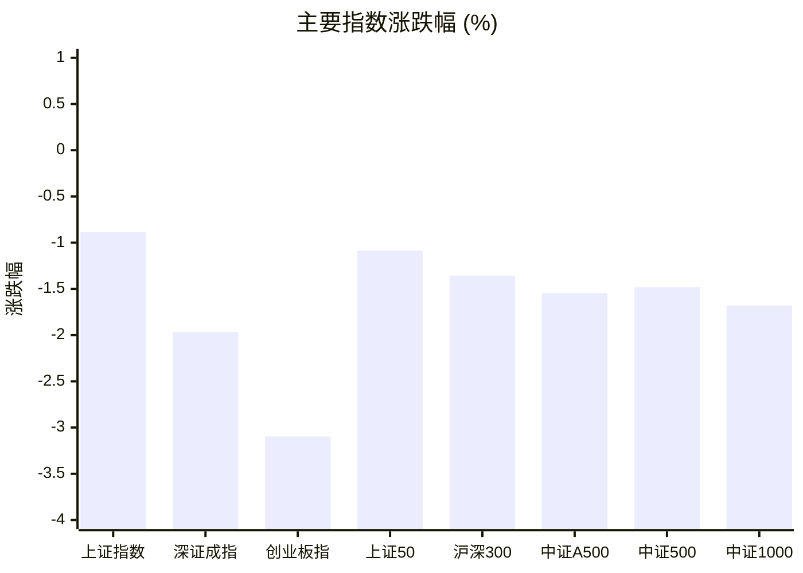
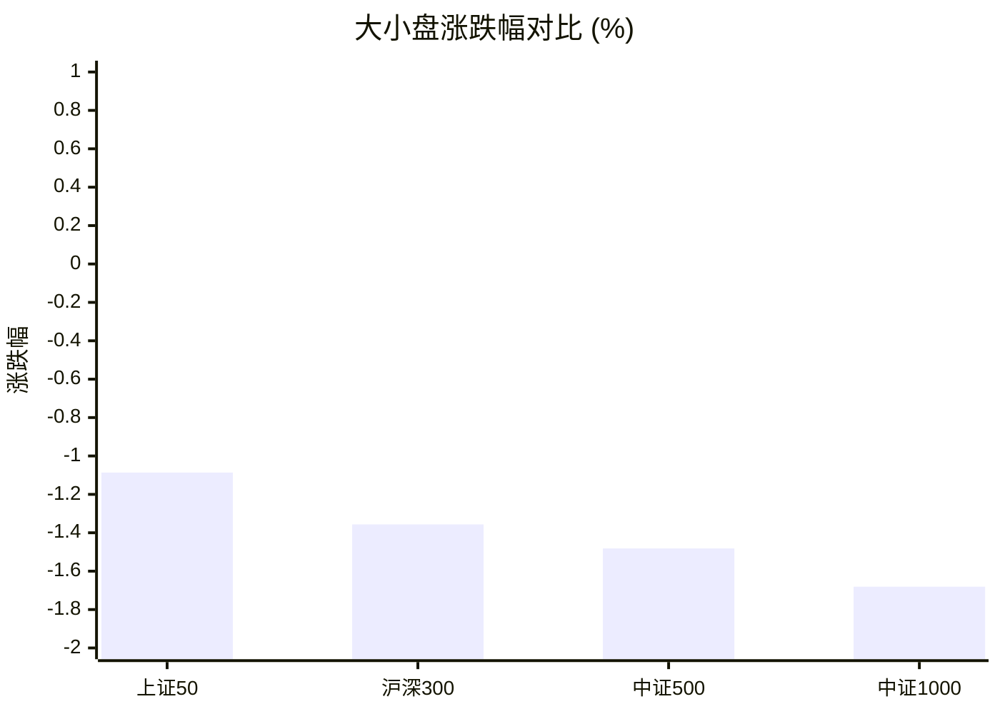
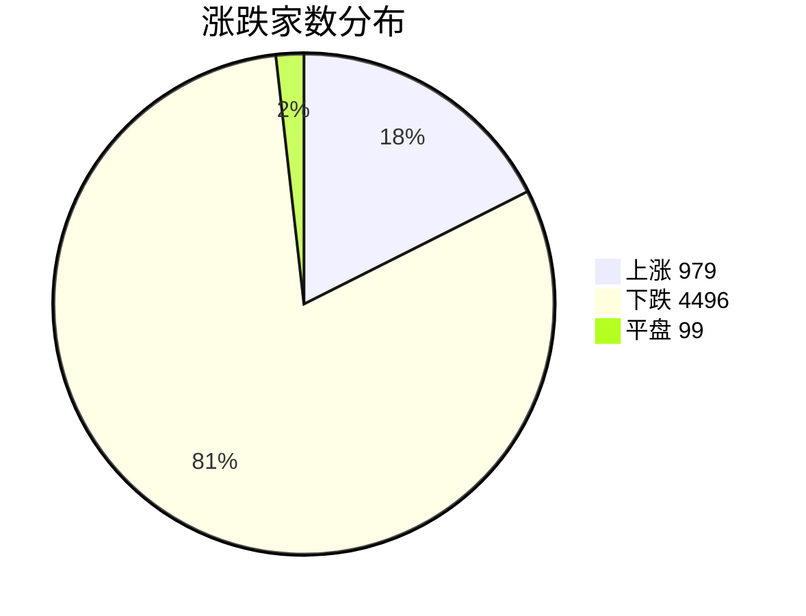
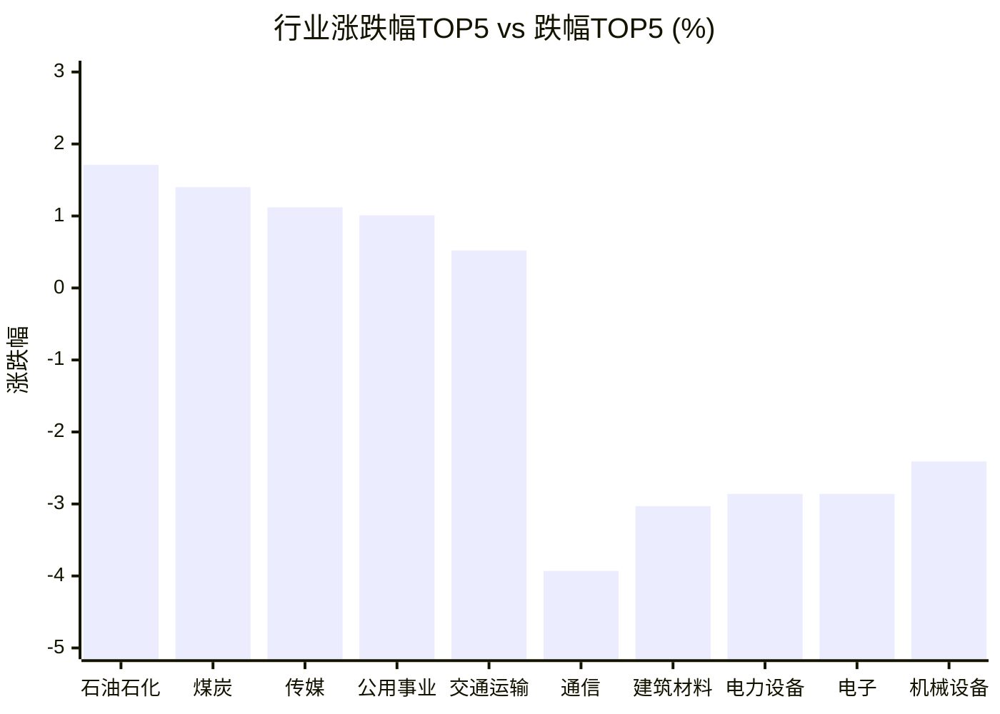

# 📊 A股收盘简报 | 2026-10-14 周三

---

## 📈 一、大盘概况

2026年10月14日 是 A 股交易日，收盘数据已可用。

### 主要指数表现

| 指数 | 收盘价 | 涨跌幅 | 涨跌点 | 成交额(亿) | 前收盘 | 开盘 | 最高 | 最低 |
|------|--------|--------|--------|-----------|--------|------|------|------|
| 上证指数 | 3767.23 | **▼0.88%** | -33.63 | 6624.92亿 | 3800.86 | 3790.63 | 3811.81 | 3761.96 |
| 深证成指 | 12110.59 | **▼1.97%** | -243.11 | 7518.99亿 | 12353.70 | 12308.64 | 12383.62 | 12097.50 |
| 创业板指 | 2866.76 | **▼3.10%** | -91.58 | 3598.38亿 | 2958.34 | 2943.01 | 2962.73 | 2863.71 |
| 上证50 | 2776.92 | **▼1.09%** | -30.50 | 1036.47亿 | 2807.42 | 2795.19 | 2806.89 | 2774.21 |
| 沪深300 | 4217.68 | **▼1.36%** | -58.00 | 3684.51亿 | 4275.68 | 4259.33 | 4281.46 | 4214.01 |
| 中证A500 | 5142.31 | **▼1.54%** | -80.56 | 4825.60亿 | 5222.87 | 5203.00 | 5231.12 | 5137.79 |
| 中证500 | 6980.11 | **▼1.48%** | -104.98 | 2298.06亿 | 7085.09 | 7066.73 | 7120.11 | 6969.02 |
| 中证1000 | 6905.17 | **▼1.68%** | -118.05 | 2808.56亿 | 7023.22 | 7001.91 | 7035.18 | 6891.60 |

### 市场整体成交

- **沪深合计成交额**: **14143.91亿**
- **较前日缩量** 2615.17亿（-15.6%）

---

## 📊 二、指数涨跌幅对比

---

## 📊 三、市值结构 — 大小盘对比

| 指数 | 涨跌幅 | 特征 |
|------|--------|------|
| 上证50 | **▼1.09%** | 超大盘 |
| 沪深300 | **▼1.36%** | 大盘 |
| 中证500 | **▼1.48%** | 中盘 |
| 中证1000 | **▼1.68%** | 小盘 |

> 📌 **风格分化明显**，大小盘走势不一致。

---

## 📉 四、市场广度
### 涨跌家数分布

### 关键统计

| 指标 | 数值 |
|------|------|
| 上涨家数 | 979 |
| 下跌家数 | 4496 |
| 平盘家数 | 99 |
| 涨停家数 | 39 |
| 跌停家数 | 13 |
| 全市场中位数 | **▼1.93%** |

---
## 🏢 五、行业表现

### 🔥 涨幅榜 TOP 10

| 排名 | 行业(申万一级) | 涨跌幅 |
|------|---------------|--------|
| 🥇 | 石油石化(申万) | **▲+1.71%** |
| 🥈 | 煤炭(申万) | **▲+1.40%** |
| 🥉 | 传媒(申万) | **▲+1.12%** |
| 4 | 公用事业(申万) | **▲+1.01%** |
| 5 | 交通运输(申万) | **▲+0.52%** |
| 6 | 食品饮料(申万) | **▲+0.45%** |
| 7 | 钢铁(申万) | **▼0.08%** |
| 8 | 银行(申万) | **▼0.12%** |
| 9 | 家用电器(申万) | **▼0.41%** |
| 10 | 非银金融(申万) | **▼0.63%** |

### ❄️ 跌幅榜 TOP 10

| 排名 | 行业(申万一级) | 涨跌幅 |
|------|---------------|--------|
| 31 | 通信(申万) | **▼3.93%** |
| 30 | 建筑材料(申万) | **▼3.03%** |
| 29 | 电力设备(申万) | **▼2.86%** |
| 28 | 电子(申万) | **▼2.86%** |
| 27 | 机械设备(申万) | **▼2.41%** |
| 26 | 汽车(申万) | **▼2.20%** |
| 25 | 有色金属(申万) | **▼1.99%** |
| 24 | 综合(申万) | **▼1.81%** |
| 23 | 基础化工(申万) | **▼1.80%** |
| 22 | 环保(申万) | **▼1.74%** |

> 📉 **行业普跌**，多数板块调整。 涨幅第一：**石油石化(申万)**（+1.71%）。 跌幅第一：**通信(申万)**（-3.93%）。

---

## 💡 六、热门概念

| 概念 | 涨跌幅 |
|------|--------|
| 冰雪旅游指数 | **▲+3.11%** |
| AI语料指数 | **▲+2.79%** |
| 短剧游戏指数 | **▲+2.66%** |
| seedance视频大模型指数 | **▲+2.21%** |
| 网络游戏指数 | **▲+2.08%** |
| Kimi指数 | **▲+1.74%** |
| 中药精选指数 | **▲+1.74%** |
| 电力股精选指数 | **▲+1.50%** |
| 水电指数 | **▲+1.48%** |
| 中船系指数 | **▲+1.43%** |

> 📌 今日热门概念集中在 **冰雪旅游指数**（+3.11%） 等方向。

---

## 💰 七、资金流向

### 主力资金概况

| 指标 | 数值(亿元) |
|------|------|
| 主力资金净流入 | -84.16 |

### 资金流入行业 TOP5

| 行业 | 净流入(亿元) |
|------|--------|
| 传媒 | 67.41 |
| 公用事业 | 32.39 |
| 石油石化 | 16.51 |
| 交通运输 | 15.17 |
| 食品饮料 | 14.12 |

> 🔴 **主力资金小幅净流出**。

---

## 🌍 八、周边市场

| 指数 | 涨跌幅 |
|------|--------|
| 标普500 | **▼0.02%** |
| 日经225 | **▼0.05%** |
| 恒生指数 | **▼0.10%** |
| 纳斯达克指数 | **▼0.15%** |
| 道琼斯工业平均 | **▼0.35%** |

> 📌 全球市场多数下跌，外围情绪偏弱。

---

## 📊 九、期货市场

| 品种 | 涨跌幅 |
|------|--------|
| IC2703 | **▼1.35%** |
| IF2703 | **▼1.40%** |
| IH2703 | **▼1.01%** |
| IM2703 | **▼1.55%** |
| T2706 | **▲+0.05%** |
| TF2706 | **▲+0.01%** |
| TL2706 | **▲+0.16%** |
| TS2706 | +0.00% |
| 沪银2709 | **▼2.65%** |
| 沪金2710 | **▼0.55%** |

---

## 📰 十、财经要闻

- A股盘前市场要闻速递（2026-10-14）
- A股每日市场要闻回顾（2026-10-14）
- A股早报2026年10月14日星期三
- 诚通证券早报 | 10月14日资讯聚焦一文全掌握
- A股低开，光通信、传媒等板块调整

---

## 🤖 十一、盘面结论

> 分析来源：AI Agent

**一句话定性：**普跌背景下出现少数行业与概念逆势走强，但全市场风险偏好偏弱，暂未形成可确认的普遍修复。

**证据：**
- 报告数据显示八个主要指数全部收跌，跌幅为0.88%至3.10%；创业板指跌幅最大，为3.10%。
- 下跌家数4496家、上涨979家，全市场涨跌幅中位数为-1.93%；跌停13家、涨停39家。
- 沪深合计成交额14143.91亿元，较前日缩量2615.17亿元（-15.6%）；主力资金净流出84.16亿元。
- 与整体走弱相反，石油石化、传媒、煤炭分别上涨1.71%、1.12%、1.40%；其余多数行业下跌。

判断：下跌覆盖面较广且成交缩量，盘面仍偏弱；少数行业和概念的相对强势属于结构性表现，单日数据不足以确认持续主线。

---

## 🎯 十二、主线轮动

1. **传媒及内容概念｜生命周期：待确认**
   - 盘面证据：传媒行业上涨1.12%，行业资金净流入67.41亿元；AI语料、短剧游戏、网络游戏概念分别上涨2.79%、2.66%、2.08%。结构化行业、概念和资金数据同向，盘面已验证该方向当日相对强势。
   - 催化验证：报告仅列新闻标题，没有可核实正文或与该方向相对应的催化证据，暂不作因果归因。
   - 确认条件：下一交易日同类报告中传媒行业及相关概念仍有相对表现，且可用行业资金数据继续显示净流入。
   - 失效条件：传媒转为行业跌幅方向，相关概念普遍走弱，或可用行业资金数据转为净流出。

2. **石油石化｜生命周期：待确认**
   - 盘面证据：石油石化上涨1.71%，居行业涨幅榜首；行业资金净流入16.51亿元。行业表现与资金数据同向，盘面已验证其当日相对强势。
   - 催化验证：报告没有提供可验证的行业催化信息，新闻标题不足以确认驱动因素。
   - 确认条件：下一交易日石油石化仍处行业相对强势方向，且可用行业资金数据维持净流入。
   - 失效条件：石油石化转为行业下跌方向，或可用行业资金数据转为净流出。

---

## 🔍 十三、明日关注

1. **观察对象：市场广度与中位数。**确认信号：上涨家数相对下跌家数改善，且全市场涨跌幅中位数回升；失效信号：下跌家数仍显著多于上涨家数且中位数继续走弱。
2. **观察对象：传媒、石油石化行业及相关资金流向。**确认信号：行业相对表现延续，且可用行业资金数据仍为净流入；失效信号：行业转弱或资金数据转为净流出。
3. **观察对象：主要指数与沪深成交额。**确认信号：主要指数跌幅收窄或转强，同时成交额不再较前日缩减；失效信号：指数跌幅扩大且成交额继续缩量。

---

## 📌 数据来源与免责声明

- **数据来源**：万得 Wind 金融数据服务
- **数据日期**：2026-10-14 收盘
- **生成时间**：2026年10月14日
- **免责声明**：本简报基于 Wind 数据自动生成，AI 分析部分（如有）仅供参考，不构成任何投资建议。市场有风险，投资需谨慎。
