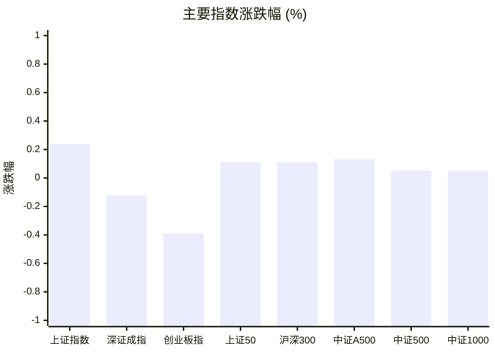
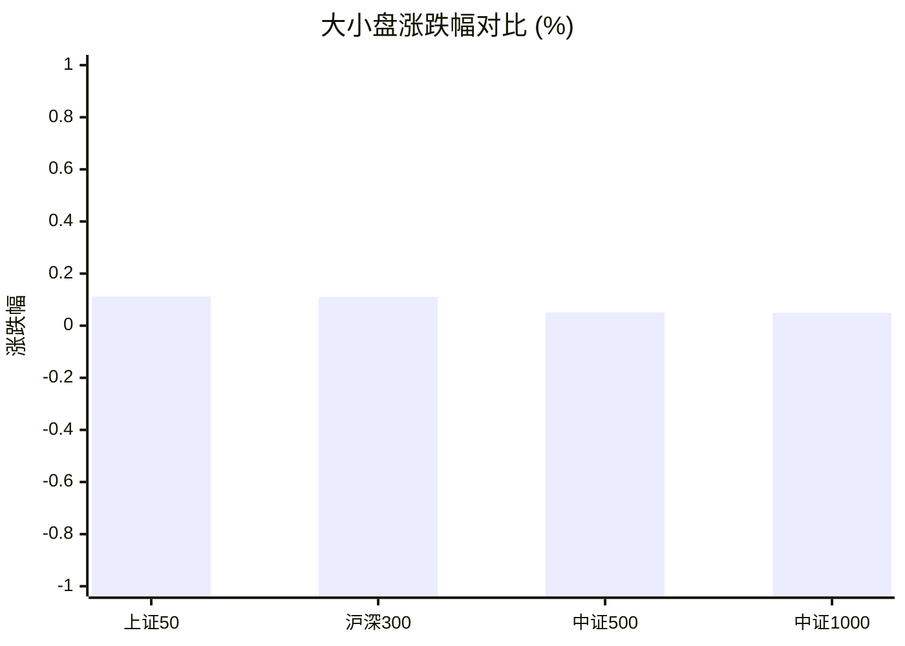
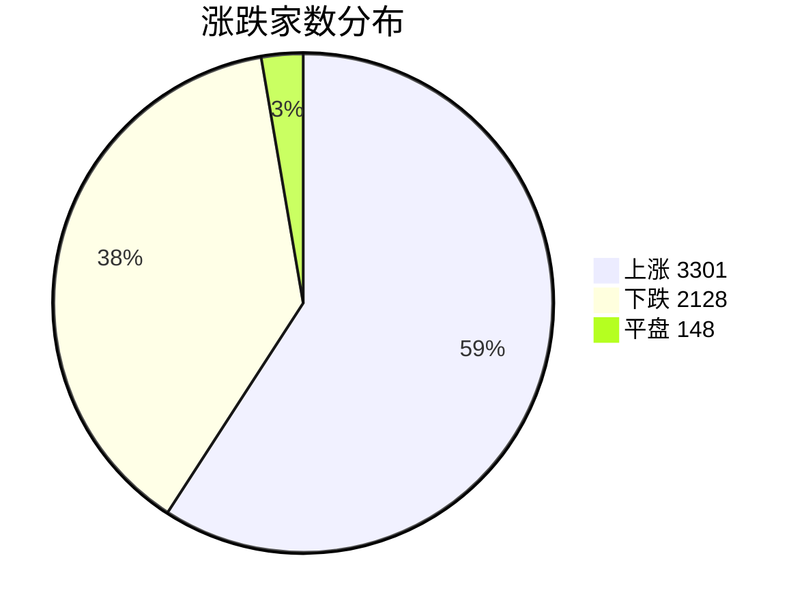
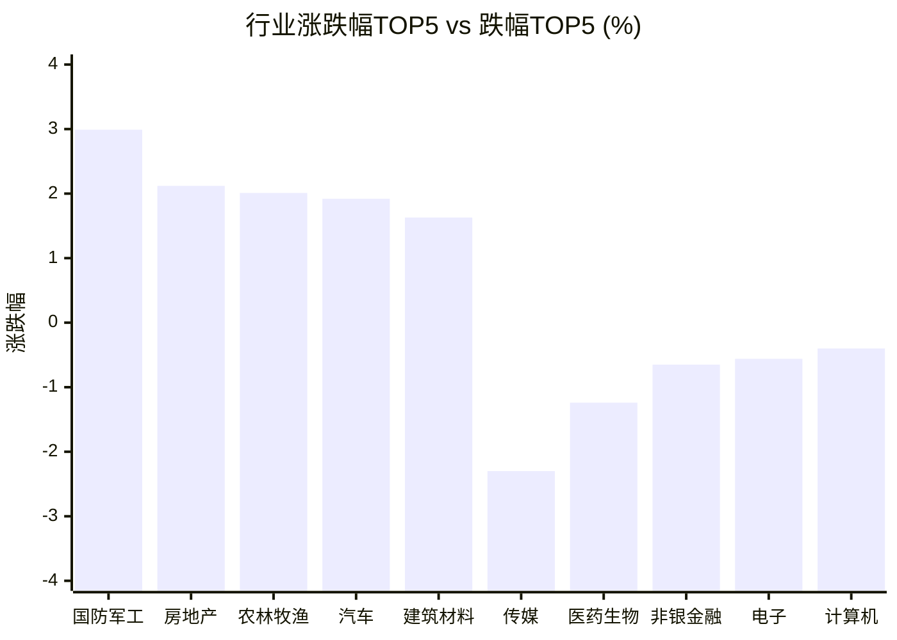

# 📊 A股收盘简报 | 2026-10-16 周五

---

## 📈 一、大盘概况

2026年10月16日 是 A 股交易日，收盘数据已可用。

### 主要指数表现

| 指数 | 收盘价 | 涨跌幅 | 涨跌点 | 成交额(亿) | 前收盘 | 开盘 | 最高 | 最低 |
|------|--------|--------|--------|-----------|--------|------|------|------|
| 上证指数 | 3716.28 | **▲+0.24%** | +8.80 | 7324.75亿 | 3707.48 | 3723.80 | 3750.77 | 3681.28 |
| 深证成指 | 11802.46 | **▼0.12%** | -14.33 | 8229.39亿 | 11816.79 | 11965.57 | 11993.85 | 11698.50 |
| 创业板指 | 2772.38 | **▼0.39%** | -10.79 | 3942.26亿 | 2783.17 | 2831.89 | 2832.13 | 2743.87 |
| 上证50 | 2768.34 | **▲+0.11%** | +3.11 | 1313.78亿 | 2765.23 | 2770.40 | 2785.15 | 2733.65 |
| 沪深300 | 4170.61 | **▲+0.11%** | +4.60 | 4137.49亿 | 4166.01 | 4189.26 | 4206.89 | 4127.94 |
| 中证A500 | 5063.78 | **▲+0.13%** | +6.70 | 5415.78亿 | 5057.08 | 5097.56 | 5122.32 | 5013.22 |
| 中证500 | 6772.75 | **▲+0.05%** | +3.50 | 2580.45亿 | 6769.25 | 6863.19 | 6907.90 | 6719.82 |
| 中证1000 | 6681.94 | **▲+0.05%** | +3.29 | 3101.19亿 | 6678.65 | 6777.39 | 6834.45 | 6626.52 |

### 市场整体成交

- **沪深合计成交额**: **15554.14亿**
- **较前日缩量** 775.82亿（-4.8%）

---

## 📊 二、指数涨跌幅对比

---

## 📊 三、市值结构 — 大小盘对比

| 指数 | 涨跌幅 | 特征 |
|------|--------|------|
| 上证50 | **▲+0.11%** | 超大盘 |
| 沪深300 | **▲+0.11%** | 大盘 |
| 中证500 | **▲+0.05%** | 中盘 |
| 中证1000 | **▲+0.05%** | 小盘 |

> 📌 **大小盘涨跌幅接近**，市场风格均衡。

---

## 📉 四、市场广度
### 涨跌家数分布

### 关键统计

| 指标 | 数值 |
|------|------|
| 上涨家数 | 3301 |
| 下跌家数 | 2128 |
| 平盘家数 | 148 |
| 涨停家数 | 63 |
| 跌停家数 | 12 |
| 全市场中位数 | **▲+0.46%** |

---
## 🏢 五、行业表现

### 🔥 涨幅榜 TOP 10

| 排名 | 行业(申万一级) | 涨跌幅 |
|------|---------------|--------|
| 🥇 | 国防军工(申万) | **▲+2.99%** |
| 🥈 | 房地产(申万) | **▲+2.12%** |
| 🥉 | 农林牧渔(申万) | **▲+2.01%** |
| 4 | 汽车(申万) | **▲+1.92%** |
| 5 | 建筑材料(申万) | **▲+1.63%** |
| 6 | 石油石化(申万) | **▲+1.32%** |
| 7 | 建筑装饰(申万) | **▲+1.31%** |
| 8 | 钢铁(申万) | **▲+1.11%** |
| 9 | 煤炭(申万) | **▲+0.90%** |
| 10 | 食品饮料(申万) | **▲+0.84%** |

### ❄️ 跌幅榜 TOP 10

| 排名 | 行业(申万一级) | 涨跌幅 |
|------|---------------|--------|
| 31 | 传媒(申万) | **▼2.30%** |
| 30 | 医药生物(申万) | **▼1.24%** |
| 29 | 非银金融(申万) | **▼0.65%** |
| 28 | 电子(申万) | **▼0.56%** |
| 27 | 计算机(申万) | **▼0.40%** |
| 26 | 社会服务(申万) | **▼0.13%** |
| 25 | 银行(申万) | **▼0.07%** |
| 24 | 商贸零售(申万) | **▼0.05%** |
| 23 | 公用事业(申万) | **▼0.04%** |
| 22 | 电力设备(申万) | **▲+0.02%** |

> 📈 **行业普涨**，多数板块收红。 涨幅第一：**国防军工(申万)**（+2.99%）。 跌幅第一：**传媒(申万)**（-2.30%）。

---

## 💡 六、热门概念

| 概念 | 涨跌幅 |
|------|--------|
| 低空经济指数 | **▲+4.75%** |
| 通用航空指数 | **▲+4.50%** |
| 化学纤维精选指数 | **▲+4.40%** |
| 航母指数 | **▲+4.34%** |
| 央企汽车指数 | **▲+4.09%** |
| 大飞机指数 | **▲+3.95%** |
| 军民融合指数 | **▲+3.90%** |
| 军工信息化指数 | **▲+3.79%** |
| 商业航天指数 | **▲+3.78%** |
| 卫星导航指数 | **▲+3.68%** |

> 📌 今日热门概念集中在 **低空经济指数**（+4.75%） 等方向。

---

## 💰 七、资金流向

### 主力资金概况

| 指标 | 数值(亿元) |
|------|------|
| 主力资金净流入 | 164.71 |

### 资金流入行业 TOP5

| 行业 | 净流入(亿元) |
|------|--------|
| 国防军工 | 60.35 |
| 汽车 | 51.85 |
| 机械设备 | 27.09 |
| 农林牧渔 | 16.82 |
| 房地产 | 15.53 |

> 🟢 **主力资金大幅净流入**，市场做多意愿强烈。

---

## 🌍 八、周边市场

| 指数 | 涨跌幅 |
|------|--------|
| 日经225 | **▲+1.39%** |
| 道琼斯工业平均 | **▲+1.08%** |
| 恒生指数 | **▲+0.41%** |
| 标普500 | **▲+0.33%** |
| 纳斯达克指数 | **▲+0.08%** |

> 📌 全球市场多数上涨，外围情绪偏暖。

---

## 📊 九、期货市场

| 品种 | 涨跌幅 |
|------|--------|
| IC2703 | **▲+0.64%** |
| IF2703 | **▲+0.11%** |
| IH2703 | **▲+0.15%** |
| IM2703 | **▲+0.18%** |
| T2706 | **▲+0.10%** |
| TF2706 | **▲+0.08%** |
| TL2706 | **▲+0.04%** |
| TS2706 | **▲+0.03%** |
| 沪银2710 | **▲+2.35%** |
| 沪金2710 | **▲+1.10%** |

---

## 📰 十、财经要闻

- 今日A股市场重要快讯汇总｜2026年10月16日
- A股早报2026年10月16日星期五
- 今日国际国内财经新闻精华摘要｜2026年10月15日
- A股收盘综述：银行保险煤炭等红利资产尾盘及时出手，部分宽基ETF明显放量
- 海外科技强势反弹，A股光通信、半导体等企业密集回购，算力板块情绪修复，创业板算力ETF广发(158049)连续2天净流入合计约0.84亿元

---

## 🤖 十一、盘面结论

> 分析来源：AI Agent

一句话定性：市场呈现指数窄幅分化、行业与主题局部活跃的结构性偏强行情。

- 证据：上证指数上涨 0.24%，但深证成指下跌 0.12%、创业板指下跌 0.39%；上证50、沪深300分别上涨 0.11%，中证500和中证1000均上涨 0.05%，说明权重与中小盘涨跌幅接近而成长指数偏弱。
- 证据：全市场上涨 3301 家、下跌 2128 家，涨停 63 家、跌停 12 家，中位数上涨 0.46%；上涨家数和涨停家数占优，但并非所有主要指数同步走强。
- 证据：沪深合计成交额 15554.14 亿元，较前日缩量 775.82 亿元（-4.8%）；在缩量背景下，行业表现仍由国防军工（+2.99%）、房地产（+2.12%）等板块领涨，传媒（-2.30%）相对承压。

---

## 🎯 十二、主线轮动

1. **国防军工及航空航天方向｜发酵**
   - 盘面证据：国防军工行业上涨 2.99%，低空经济、通用航空、航母、大飞机等热门概念涨幅位于前列，主力资金净流入行业中国防军工为 60.35 亿元。
   - 催化验证：行业、概念与资金流向三类结构化数据同向，盘面已验证；报告新闻仅作为背景素材，不单独作为上涨原因。
   - 确认条件：下一交易日该方向继续处于行业或概念涨幅前列，且资金流入行业排名保持靠前。
   - 失效条件：行业涨幅排名明显回落、相关概念转跌，或资金流入不再支持时，主线判断失效。

2. **房地产及建筑链｜待确认**
   - 盘面证据：房地产上涨 2.12%，建筑材料上涨 1.63%、建筑装饰上涨 1.31%，房地产同时位列主力资金净流入行业 TOP5（15.53 亿元）。
   - 催化验证：行业涨幅和资金流向已有盘面响应，但成交额缩量，持续性仍待确认。
   - 确认条件：下一交易日房地产及建筑相关行业继续上涨并维持资金流入，且不被少数板块单独上涨所替代。
   - 失效条件：相关行业转跌或资金流向转弱，同时市场广度收窄时，方向降级为短线轮动。

---

## 🔍 十三、明日关注

1. **观察对象：沪深合计成交额与主要指数同步性。** 确认信号：成交额较本日回升且上证、深证、创业板至少保持同向改善；失效信号：继续缩量并伴随主要指数涨跌分化扩大。
2. **观察对象：国防军工及航空航天相关行业、概念。** 确认信号：相关行业或概念继续位居涨幅前列，且资金流入行业排名保持靠前；失效信号：行业和概念涨幅同时回落、资金流向不再支持。
3. **观察对象：房地产及建筑链的持续性。** 确认信号：房地产、建筑材料或建筑装饰继续收红并出现资金流入；失效信号：相关行业转跌，或上涨家数与涨停家数明显收窄。

---

## 📌 数据来源与免责声明

- **数据来源**：万得 Wind 金融数据服务
- **数据日期**：2026-10-16 收盘
- **生成时间**：2026年10月16日
- **免责声明**：本简报基于 Wind 数据自动生成，AI 分析部分（如有）仅供参考，不构成任何投资建议。市场有风险，投资需谨慎。
