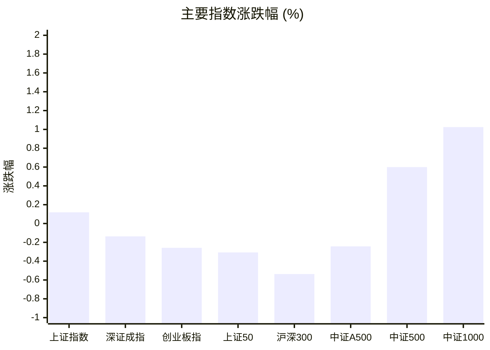
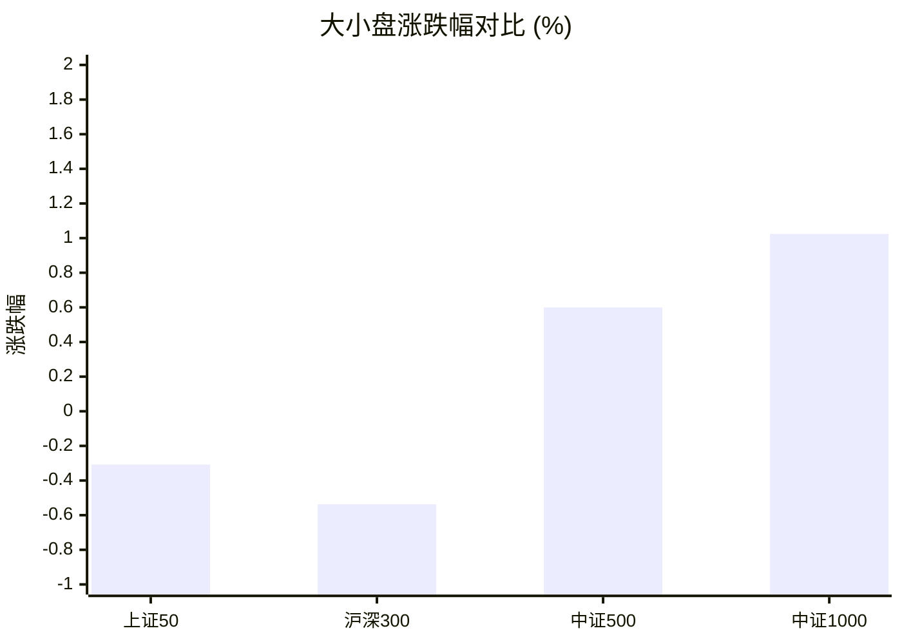
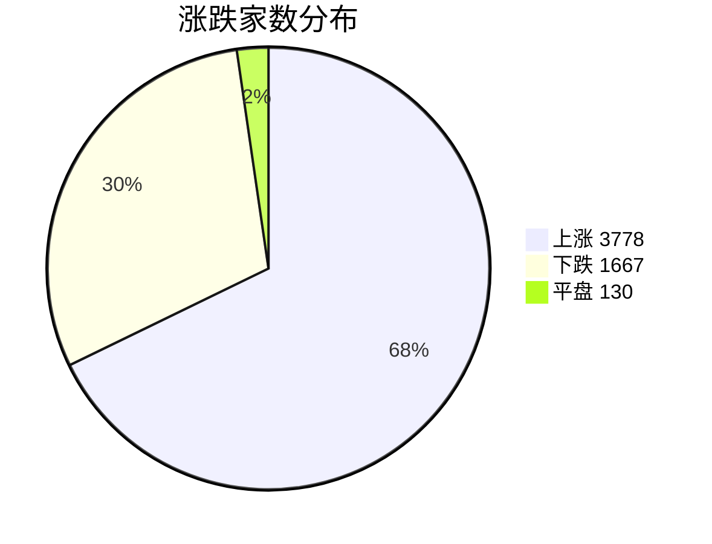
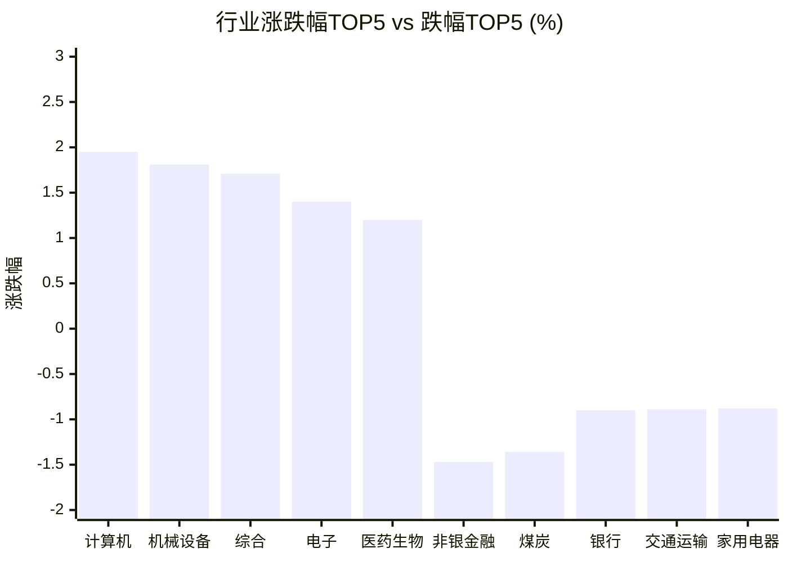

# 📊 A股收盘简报 | 2026-10-20 周二

---

## 📈 一、大盘概况

2026年10月20日 是 A 股交易日，收盘数据已可用。

### 主要指数表现

| 指数 | 收盘价 | 涨跌幅 | 涨跌点 | 成交额(亿) | 前收盘 | 开盘 | 最高 | 最低 |
|------|--------|--------|--------|-----------|--------|------|------|------|
| 上证指数 | 3735.37 | **▲+0.12%** | +4.45 | 6999.70亿 | 3730.92 | 3718.44 | 3740.07 | 3702.44 |
| 深证成指 | 11801.29 | **▼0.14%** | -16.13 | 7561.37亿 | 11817.42 | 11774.39 | 11938.00 | 11691.41 |
| 创业板指 | 2739.20 | **▼0.26%** | -7.09 | 3744.85亿 | 2746.29 | 2732.68 | 2790.12 | 2706.41 |
| 上证50 | 2765.77 | **▼0.31%** | -8.53 | 1219.02亿 | 2774.30 | 2763.33 | 2766.77 | 2734.39 |
| 沪深300 | 4152.11 | **▼0.54%** | -22.42 | 3962.29亿 | 4174.53 | 4157.93 | 4175.21 | 4113.14 |
| 中证A500 | 5057.88 | **▼0.24%** | -12.31 | 5224.99亿 | 5070.19 | 5049.00 | 5090.69 | 5008.08 |
| 中证500 | 6841.44 | **▲+0.60%** | +40.78 | 2510.07亿 | 6800.66 | 6773.45 | 6902.09 | 6745.14 |
| 中证1000 | 6766.90 | **▲+1.02%** | +68.60 | 2813.98亿 | 6698.30 | 6678.64 | 6817.38 | 6642.30 |

### 市场整体成交

- **沪深合计成交额**: **14561.07亿**
- **较前日放量** 186.02亿（+1.3%）

---

## 📊 二、指数涨跌幅对比

---

## 📊 三、市值结构 — 大小盘对比

| 指数 | 涨跌幅 | 特征 |
|------|--------|------|
| 上证50 | **▼0.31%** | 超大盘 |
| 沪深300 | **▼0.54%** | 大盘 |
| 中证500 | **▲+0.60%** | 中盘 |
| 中证1000 | **▲+1.02%** | 小盘 |

> 📌 **小盘强势领跑**，中证500/中证1000涨幅远超上证50，资金向中小市值扩散。

---

## 📉 四、市场广度
### 涨跌家数分布

### 关键统计

| 指标 | 数值 |
|------|------|
| 上涨家数 | 3778 |
| 下跌家数 | 1667 |
| 平盘家数 | 130 |
| 涨停家数 | 57 |
| 跌停家数 | 7 |
| 全市场中位数 | **▲+0.96%** |

---
## 🏢 五、行业表现

### 🔥 涨幅榜 TOP 10

| 排名 | 行业(申万一级) | 涨跌幅 |
|------|---------------|--------|
| 🥇 | 计算机(申万) | **▲+1.95%** |
| 🥈 | 机械设备(申万) | **▲+1.81%** |
| 🥉 | 综合(申万) | **▲+1.71%** |
| 4 | 电子(申万) | **▲+1.40%** |
| 5 | 医药生物(申万) | **▲+1.20%** |
| 6 | 社会服务(申万) | **▲+0.78%** |
| 7 | 汽车(申万) | **▲+0.68%** |
| 8 | 传媒(申万) | **▲+0.60%** |
| 9 | 美容护理(申万) | **▲+0.53%** |
| 10 | 建筑材料(申万) | **▲+0.51%** |

### ❄️ 跌幅榜 TOP 10

| 排名 | 行业(申万一级) | 涨跌幅 |
|------|---------------|--------|
| 31 | 非银金融(申万) | **▼1.47%** |
| 30 | 煤炭(申万) | **▼1.36%** |
| 29 | 银行(申万) | **▼0.90%** |
| 28 | 交通运输(申万) | **▼0.89%** |
| 27 | 家用电器(申万) | **▼0.88%** |
| 26 | 有色金属(申万) | **▼0.88%** |
| 25 | 电力设备(申万) | **▼0.74%** |
| 24 | 钢铁(申万) | **▼0.68%** |
| 23 | 房地产(申万) | **▼0.58%** |
| 22 | 公用事业(申万) | **▼0.42%** |

> 📊 **行业分化明显**，19涨/12跌。 涨幅第一：**计算机(申万)**（+1.95%）。 跌幅第一：**非银金融(申万)**（-1.47%）。

---

## 💡 六、热门概念

| 概念 | 涨跌幅 |
|------|--------|
| 智能音箱指数 | **▲+6.01%** |
| MCU芯片指数 | **▲+5.34%** |
| 机器视觉指数 | **▲+4.71%** |
| MLOps指数 | **▲+4.64%** |
| 外骨骼机器人指数 | **▲+4.49%** |
| AI办公指数 | **▲+4.37%** |
| 人形机器人指数 | **▲+4.16%** |
| 传感器指数 | **▲+4.05%** |
| 宇树机器人指数 | **▲+4.03%** |
| 物联网指数 | **▲+3.94%** |

> 📌 今日热门概念集中在 **智能音箱指数**（+6.01%） 等方向。

---

## 💰 七、资金流向

### 主力资金概况

| 指标 | 数值(亿元) |
|------|------|
| 主力资金净流入 | 269.60 |

### 资金流入行业 TOP5

| 行业 | 净流入(亿元) |
|------|--------|
| 电子 | 139.04 |
| 机械设备 | 54.36 |
| 计算机 | 53.14 |
| 医药生物 | 41.89 |
| 通信 | 30.36 |

> 🟢 **主力资金大幅净流入**，市场做多意愿强烈。

---

## 🌍 八、周边市场

| 指数 | 涨跌幅 |
|------|--------|
| 纳斯达克指数 | **▲+1.11%** |
| 标普500 | **▲+0.41%** |
| 道琼斯工业平均 | **▼0.07%** |
| 日经225 | **▼1.30%** |
| 恒生指数 | **▼1.32%** |

> 📌 全球市场多数下跌，外围情绪偏弱。

---

## 📊 九、期货市场

| 品种 | 涨跌幅 |
|------|--------|
| 沪深300期货 | **▼0.98%** |
| CFFEX沪深300期货次活跃 | **▼0.90%** |
| OSE10年期日本国债期货活跃 | +0.00% |
| OSE迷你长期国债期货活跃 | +0.00% |
| OSE迷你长期国债期货次活跃 | +0.00% |
| OSE10年期日本国债期货次活跃 | +0.00% |
| COMEX 1盎司黄金 | +0.00% |
| COMEX 1盎司黄金次活跃 | +0.00% |
| SHFE白银 | **▲+0.08%** |
| SHFE白银次活跃 | **▲+0.07%** |

---

## 📰 十、财经要闻

- 诚通证券早报 | 10月20日资讯聚焦一文全掌握
- A股收盘综述：护盘资金尾盘出手助力沪指收红！宁德时代、中际旭创、新易盛打压创指
- 元鼎证券观察：10 月 20 日 A 股收盘复盘，科技成长主线爆发，权重板块承压调整
- 【A股午间收盘快报】 创业板指上涨0.27% 全市场超3900股上涨 物理AI概念领涨
- 元鼎证券观察：10月20日A股收盘复盘，机器人与科技板块成为市场关注焦点

---

## 🤖 十一、盘面结论

> 分析来源：AI Agent

一句话定性：今日为中小盘偏强、权重偏弱的分化行情，个股上涨面较广，科技与机器人相关方向活跃，但尚不能据此确认持续主线。

- 证据：中证1000上涨1.02%、中证500上涨0.60%，沪深300下跌0.54%、上证50下跌0.31%；上证指数微涨0.12%，深证成指和创业板指分别下跌0.14%、0.26%，指数间表现分化。
- 证据：上涨3778家、下跌1667家、平盘130家，全市场涨跌幅中位数为+0.96%，涨停57家、跌停7家；沪深成交14561.07亿元，较前日增加1.3%，支持“上涨面较广”的判断，量能扩张幅度有限。
- 证据：计算机、机械设备、电子分别上涨1.95%、1.81%、1.40%，对应行业净流入53.14亿、54.36亿、139.04亿元；非银金融、银行分别下跌1.47%、0.90%。成长方向的价格与资金数据同向，金融权重仍偏弱，不能把局部活跃外推为全市场同步走强。

---

## 🎯 十二、主线轮动

1. **计算机与电子相关科技方向**。生命周期判断：待确认，单日强势不足以判断加速。盘面证据：计算机领涨申万一级行业，电子上涨1.40%；MCU芯片、MLOps、AI办公概念分别上涨5.34%、4.64%、4.37%，计算机与电子均出现在资金流入行业TOP5。催化验证：科技方向的价格与资金响应已有数据支持，但报告未提供可核验的具体事件细节，新闻标题不能确认上涨原因，事件催化仍未验证。确认条件：下一交易日报告中相关行业继续上涨并保持相对领先，相关概念仍活跃，行业资金流入同向。失效条件：相关行业转跌、概念热度回落，或价格与资金方向出现背离。

2. **机械设备与机器人相关方向**。生命周期判断：待确认，暂视为活跃轮动候选。盘面证据：机械设备上涨1.81%、净流入54.36亿元；机器视觉、外骨骼机器人、人形机器人分别上涨4.71%、4.49%、4.16%。催化验证：行业与概念上涨有结构化数据支持；报告没有可验证的产业事件细节，不能仅凭新闻标题认定催化，事件催化未验证。确认条件：机械设备继续位居行业涨幅前列，机器人相关概念保持上涨，行业资金数据继续支持。失效条件：机械设备转弱、相关概念退出活跃榜单或转跌；若仅未进入TOP10，只能判断领先证据减弱，不能推断具体跌幅。

---

## 🔍 十三、明日关注

1. **观察对象：上涨广度与成交额。** 确认信号：上涨家数继续多于下跌家数、全市场涨跌幅中位数保持正值，成交额较前日增加，涨停家数仍多于跌停家数；失效信号：下跌家数反超上涨家数、中位数转负，或成交额收缩且跌停家数增加，表明上涨扩散减弱。
2. **观察对象：科技与机器人相关方向。** 确认信号：计算机、电子、机械设备继续上涨并保持行业相对领先，相关概念仍在热门榜单，行业资金流向同向支持；失效信号：行业转跌、概念领先证据减弱，或行业价格与资金方向背离，持续性判断需下修。
3. **观察对象：大小盘风格与金融权重。** 确认信号：中证500、中证1000维持上涨，同时沪深300、上证50及银行、非银金融转涨，表明上涨向权重扩散；失效信号：权重继续下跌且中小盘同步转弱，表明今日结构性强势未能延续。

---

## 📌 数据来源与免责声明

- **数据来源**：万得 Wind 金融数据服务
- **数据日期**：2026-10-20 收盘
- **生成时间**：2026年10月20日
- **免责声明**：本简报基于 Wind 数据自动生成，AI 分析部分（如有）仅供参考，不构成任何投资建议。市场有风险，投资需谨慎。
