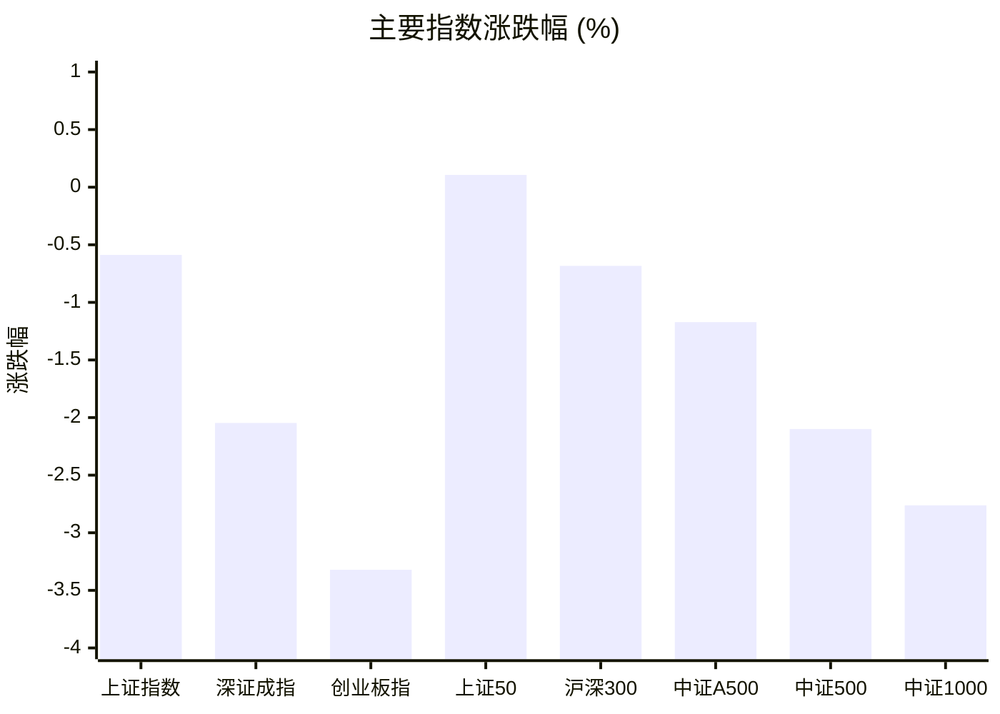
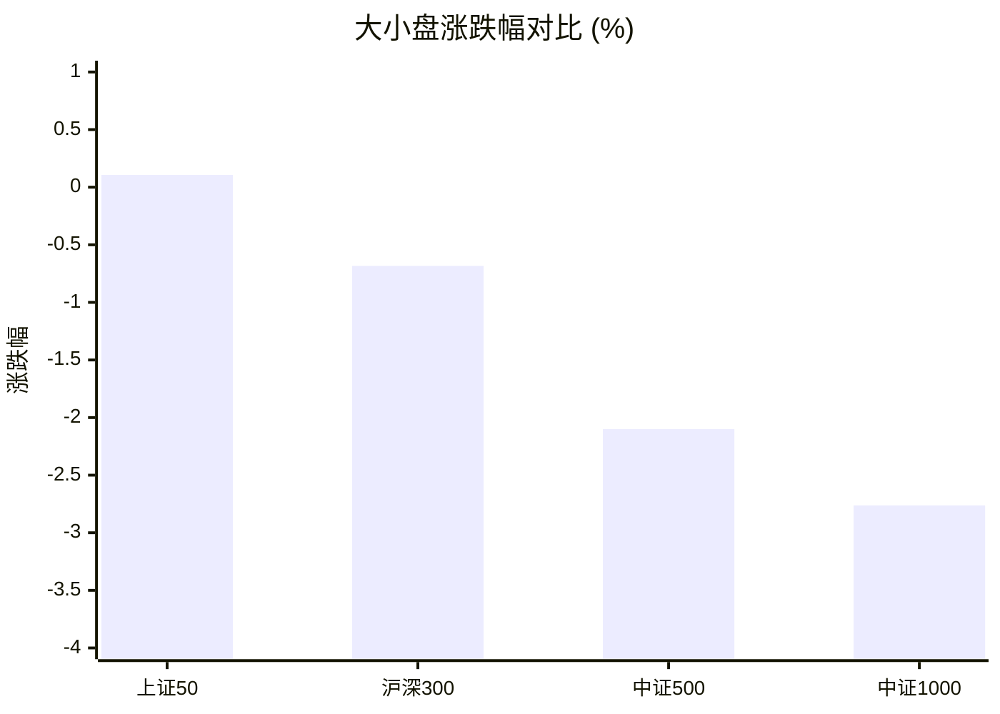
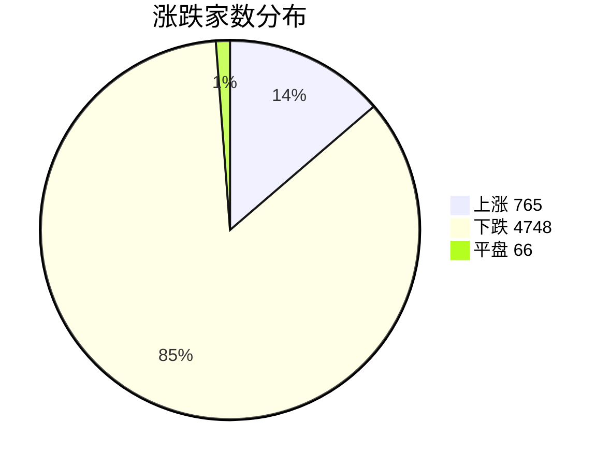
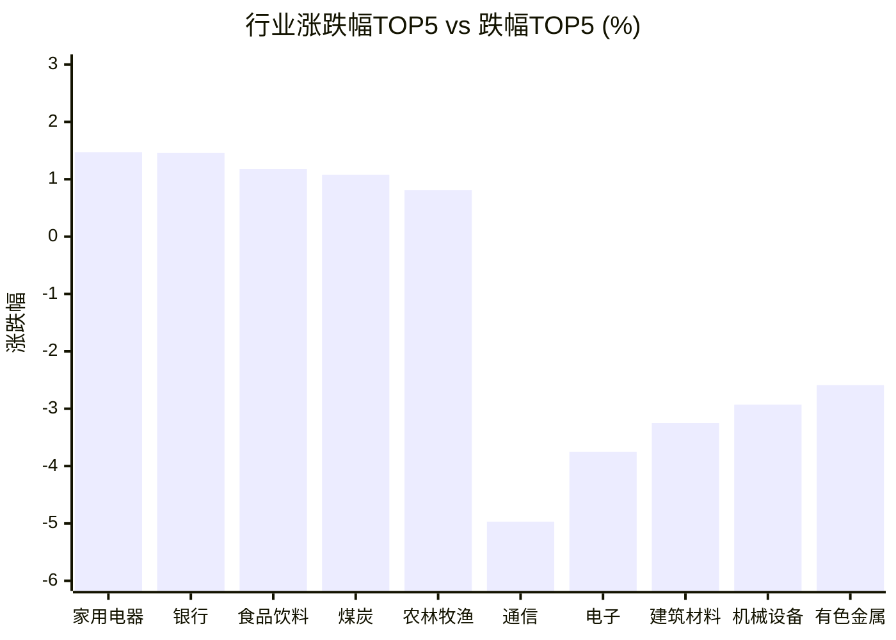

# 📊 A股收盘简报 | 2026-11-13 周五

---

## 📈 一、大盘概况

2026年11月13日 是 A 股交易日，收盘数据已可用。

### 主要指数表现

| 指数 | 收盘价 | 涨跌幅 | 涨跌点 | 成交额(亿) | 前收盘 | 开盘 | 最高 | 最低 |
|------|--------|--------|--------|-----------|--------|------|------|------|
| 上证指数 | 3634.35 | **▼0.59%** | -21.48 | 7706.14亿 | 3655.83 | 3658.72 | 3669.44 | 3623.84 |
| 深证成指 | 10968.79 | **▼2.05%** | -229.19 | 8850.54亿 | 11197.98 | 11236.16 | 11253.31 | 10941.11 |
| 创业板指 | 2426.08 | **▼3.32%** | -83.35 | 4353.34亿 | 2509.43 | 2525.39 | 2528.99 | 2417.22 |
| 上证50 | 2775.02 | **▲+0.11%** | +2.95 | 1300.48亿 | 2772.07 | 2768.91 | 2781.02 | 2762.30 |
| 沪深300 | 4016.29 | **▼0.68%** | -27.64 | 4602.46亿 | 4043.93 | 4047.77 | 4052.06 | 4004.50 |
| 中证A500 | 4842.51 | **▼1.17%** | -57.41 | 5945.62亿 | 4899.92 | 4907.23 | 4913.55 | 4827.96 |
| 中证500 | 6465.49 | **▼2.10%** | -138.66 | 2801.48亿 | 6604.15 | 6624.75 | 6645.62 | 6449.34 |
| 中证1000 | 6357.26 | **▼2.76%** | -180.58 | 3242.00亿 | 6537.84 | 6554.06 | 6581.35 | 6341.45 |

### 市场整体成交

- **沪深合计成交额**: **16556.68亿**
- **较前日缩量** 2764.09亿（-14.3%）

---

## 📊 二、指数涨跌幅对比

---

## 📊 三、市值结构 — 大小盘对比

| 指数 | 涨跌幅 | 特征 |
|------|--------|------|
| 上证50 | **▲+0.11%** | 超大盘 |
| 沪深300 | **▼0.68%** | 大盘 |
| 中证500 | **▼2.10%** | 中盘 |
| 中证1000 | **▼2.76%** | 小盘 |

> 📌 **大盘蓝筹占优**，上证50领涨，市场偏好核心资产。

---

## 📉 四、市场广度
### 涨跌家数分布

### 关键统计

| 指标 | 数值 |
|------|------|
| 上涨家数 | 765 |
| 下跌家数 | 4748 |
| 平盘家数 | 66 |
| 涨停家数 | 38 |
| 跌停家数 | 39 |
| 全市场中位数 | **▼2.00%** |

---
## 🏢 五、行业表现

### 🔥 涨幅榜 TOP 10

| 排名 | 行业(申万一级) | 涨跌幅 |
|------|---------------|--------|
| 🥇 | 家用电器(申万) | **▲+1.47%** |
| 🥈 | 银行(申万) | **▲+1.46%** |
| 🥉 | 食品饮料(申万) | **▲+1.18%** |
| 4 | 煤炭(申万) | **▲+1.08%** |
| 5 | 农林牧渔(申万) | **▲+0.81%** |
| 6 | 石油石化(申万) | **▲+0.56%** |
| 7 | 非银金融(申万) | **▲+0.08%** |
| 8 | 公用事业(申万) | **▼0.01%** |
| 9 | 交通运输(申万) | **▼0.33%** |
| 10 | 计算机(申万) | **▼0.58%** |

### ❄️ 跌幅榜 TOP 10

| 排名 | 行业(申万一级) | 涨跌幅 |
|------|---------------|--------|
| 31 | 通信(申万) | **▼4.97%** |
| 30 | 电子(申万) | **▼3.75%** |
| 29 | 建筑材料(申万) | **▼3.25%** |
| 28 | 机械设备(申万) | **▼2.93%** |
| 27 | 有色金属(申万) | **▼2.59%** |
| 26 | 电力设备(申万) | **▼2.32%** |
| 25 | 房地产(申万) | **▼2.21%** |
| 24 | 基础化工(申万) | **▼2.11%** |
| 23 | 医药生物(申万) | **▼1.78%** |
| 22 | 商贸零售(申万) | **▼1.76%** |

> 📉 **行业普跌**，多数板块调整。 涨幅第一：**家用电器(申万)**（+1.47%）。 跌幅第一：**通信(申万)**（-4.97%）。

---

## 💡 六、热门概念

| 概念 | 涨跌幅 |
|------|--------|
| 猪产业指数 | **▲+2.01%** |
| seedance视频大模型指数 | **▲+1.92%** |
| 银行精选指数 | **▲+1.73%** |
| 央企银行指数 | **▲+1.56%** |
| 饮料制造精选指数 | **▲+1.36%** |
| 保险精选指数 | **▲+1.20%** |
| 白色家电精选指数 | **▲+1.06%** |
| 鸡产业指数 | **▲+1.00%** |
| 央企煤炭指数 | **▲+0.86%** |
| 汇金持股指数 | **▲+0.83%** |

> 📌 今日热门概念集中在 **猪产业指数**（+2.01%） 等方向。

---

## 💰 七、资金流向

### 主力资金概况

| 指标 | 数值(亿元) |
|------|------|
| 主力资金净流入 | -449.97 |

### 资金流入行业 TOP5

| 行业 | 净流入(亿元) |
|------|--------|
| 银行(申万) | 41.06 |
| 计算机(申万) | 26.62 |
| 传媒(申万) | 24.67 |
| 家用电器(申万) | 10.86 |
| 汽车(申万) | 9.40 |

> 🔴 **主力资金大幅净流出**，市场谨慎情绪升温。

---

## 🌍 八、周边市场

| 指数 | 涨跌幅 |
|------|--------|
| 日经225 | +0.00% |
| 标普500 | **▼0.35%** |
| 道琼斯工业平均 | **▼0.36%** |
| 纳斯达克指数 | **▼0.39%** |
| 恒生指数 | **▼1.58%** |

> 📌 全球市场多数下跌，外围情绪偏弱。

---

## 📊 九、期货市场

| 品种 | 涨跌幅 |
|------|--------|
| IC2611 | **▼2.63%** |
| IC2612 | **▼2.73%** |
| IC2703 | **▼2.87%** |
| IC2706 | **▼3.01%** |
| IF2611 | **▼1.17%** |
| IF2612 | **▼1.26%** |
| IF2703 | **▼1.44%** |
| IF2706 | **▼1.69%** |
| IH2611 | **▼0.22%** |
| IH2612 | **▼0.28%** |

---

## 📰 十、财经要闻

- A股盘前市场要闻速递（2026-11-13）
- 今日A股市场重要快讯汇总｜2026年11月13日
- A股早报2026年11月13日星期五
- A股早报2026年11月13日星期五
- 11月13日投资早报|英力特拟购买宝丰光伏100%股权股票停牌，华虹宏力拟3亿元—5亿元回购股份，建投能源6.81亿元竞得三峡蒙能22%股权

---

## 🤖 十一、盘面结论

> 分析来源：AI Agent

**一句话定性（Agent 判断）：个股普跌、蓝筹相对抗跌，盘面呈现缩量调整中的防御性分化，尚无广泛修复证据。**

- **证据一：指数与风格。** 上证指数下跌0.59%，深证成指下跌2.05%，创业板指下跌3.32%；上证50上涨0.11%，中证500、中证1000分别下跌2.10%、2.76%，大盘蓝筹相对占优。
- **证据二：广度与量能。** 上涨765家、下跌4748家、平盘66家，全市场涨跌幅中位数为-2.00%；涨停38家、跌停39家。沪深成交16556.68亿元，较前日缩量14.3%，多数个股的下跌与量能收缩并存。
- **证据三：行业与资金。** 银行、家用电器分别上涨1.46%、1.47%，对应行业净流入41.06亿元、10.86亿元；通信、电子分别下跌4.97%、3.75%，全市场主力资金净流入为-449.97亿元。局部行业的价格与资金同向表现，尚未扩散为全市场走强。

**判断边界：** 本报告仅提供当日截面与成交额的前日对比，不能据此确认持续轮动或主线加速；新闻多为汇总标题，未提供可核验的具体催化，故不据此解释涨跌原因。

---

## 🎯 十二、主线轮动

以下为当日相对强势的候选方向，持续性均待确认。

1. **银行方向｜生命周期：待确认（Agent 判断）。** **盘面证据：** 银行上涨1.46%，行业净流入41.06亿元；银行精选、央企银行概念分别上涨1.73%、1.56%，上证50上涨0.11%，行业、概念及资金方向一致。**催化验证：** 价格与资金表现已获结构化数据支持，但现有新闻不足以核验具体事件催化，催化标记为“未验证”。**确认条件：** 下一交易日银行保持行业相对强势，相关银行概念同步走强，银行行业资金继续净流入。**失效条件：** 银行转弱、相关概念同步回落，或行业资金转为净流出，则防御性延续判断失去支持。
2. **家电消费方向｜生命周期：待确认（Agent 判断）。** **盘面证据：** 家用电器上涨1.47%，居行业涨幅榜首位，行业净流入10.86亿元；白色家电精选概念上涨1.06%。**催化验证：** 行业、概念与资金同向，但报告未提供可核验的家电事件催化，催化标记为“未验证”。**确认条件：** 下一交易日家用电器继续处于行业强势端，白色家电精选同步上涨，行业资金维持净流入。**失效条件：** 行业与概念同步转跌，或行业资金转为净流出，则不能确认该方向延续。

---

## 🔍 十三、明日关注

以下“明日”指下一交易日。

1. **观察对象：全市场修复的广度与量能。确认信号：** 上涨家数增加、下跌家数减少，全市场涨跌幅中位数改善，且成交额回升，指数同步转强。**失效信号：** 下跌家数继续占优、中位数进一步走弱，且缩量或指数下跌延续，则普遍修复判断不成立。
2. **观察对象：银行与家电的防御性表现。确认信号：** 两行业维持行业榜单相对强势，相关概念同步走强，行业资金持续净流入。**失效信号：** 两行业及对应概念转弱，或行业资金转为净流出，则当日局部强势的延续性不足。
3. **观察对象：通信、电子与成长指数的止跌情况。确认信号：** 通信、电子跌幅收窄或转涨，创业板指、中证1000同步改善，并伴随市场上涨家数增加。**失效信号：** 通信、电子继续位居行业跌幅前列，成长指数继续下跌，市场广度未改善，则止跌信号尚未形成。

---

## 📌 数据来源与免责声明

- **数据来源**：万得 Wind 金融数据服务
- **数据日期**：2026-11-13 收盘
- **生成时间**：2026年11月13日
- **免责声明**：本简报基于 Wind 数据自动生成，AI 分析部分（如有）仅供参考，不构成任何投资建议。市场有风险，投资需谨慎。
