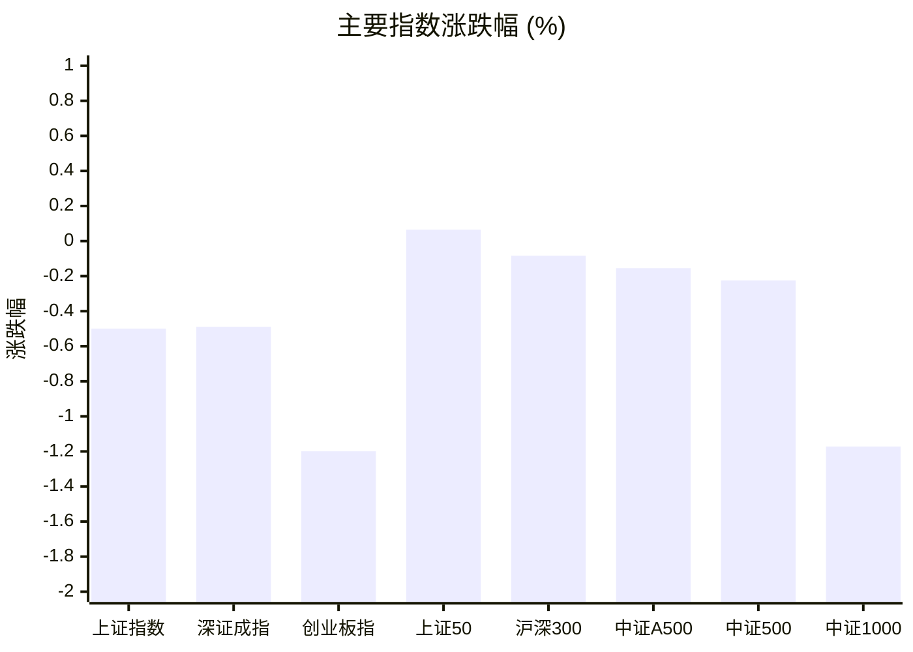
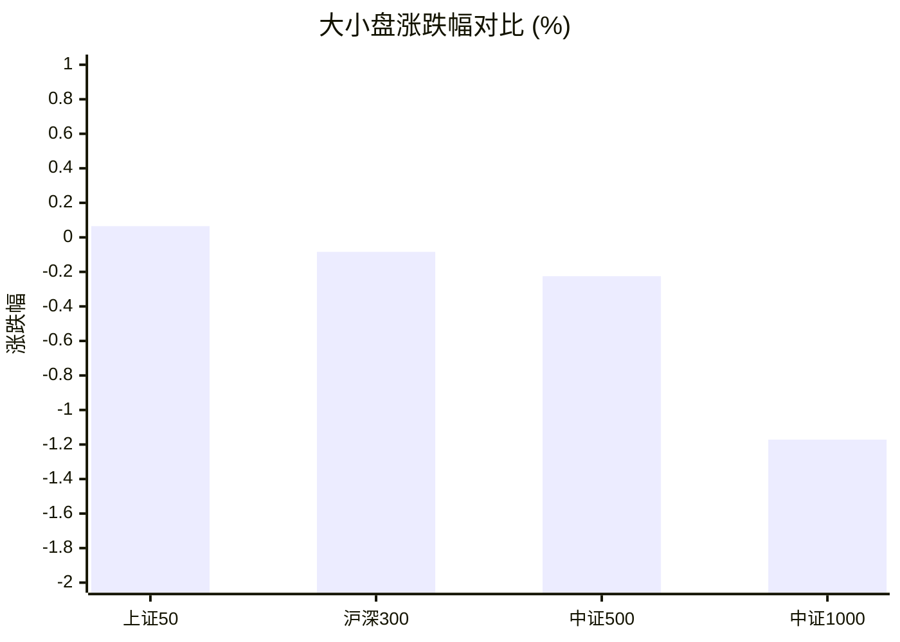
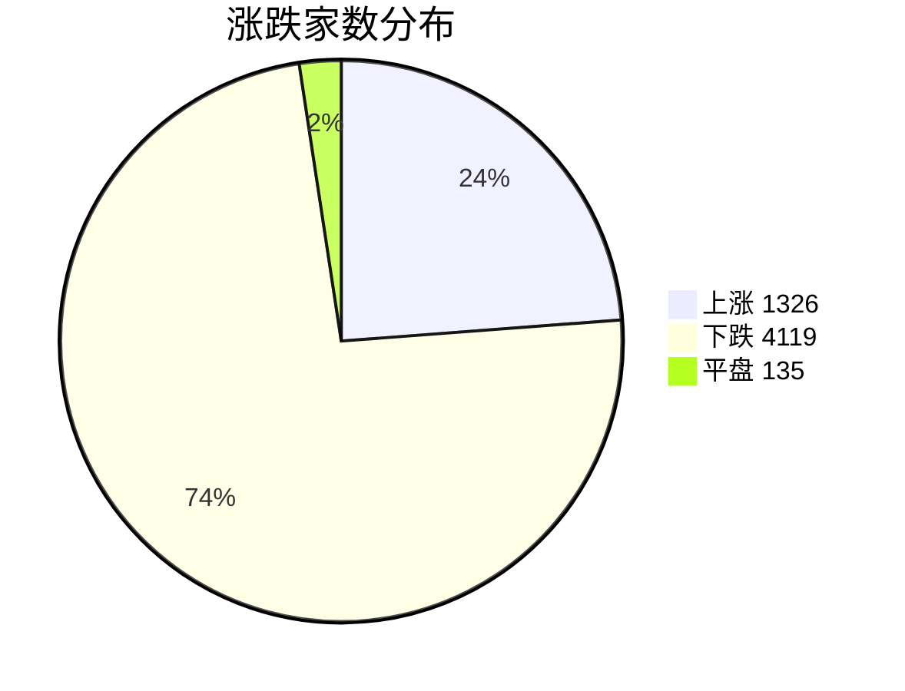
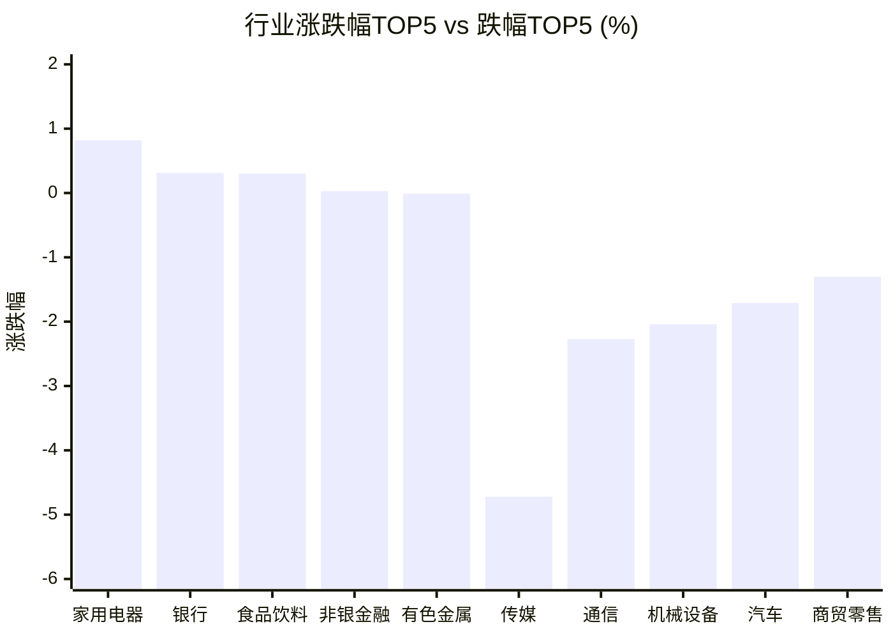

# 📊 A股收盘简报 | 2026-11-17 周二

---

## 📈 一、大盘概况

2026年11月17日 是 A 股交易日，收盘数据已可用。

### 主要指数表现

| 指数 | 收盘价 | 涨跌幅 | 涨跌点 | 成交额(亿) | 前收盘 | 开盘 | 最高 | 最低 |
|------|--------|--------|--------|-----------|--------|------|------|------|
| 上证指数 | 3584.58 | **▼0.50%** | -17.99 | 6905.15亿 | 3602.57 | 3585.67 | 3604.98 | 3565.59 |
| 深证成指 | 10638.52 | **▼0.49%** | -52.26 | 7671.80亿 | 10690.78 | 10605.17 | 10768.06 | 10556.29 |
| 创业板指 | 2292.20 | **▼1.20%** | -27.82 | 3658.32亿 | 2320.02 | 2299.97 | 2343.15 | 2263.74 |
| 上证50 | 2768.36 | **▲+0.06%** | +1.79 | 1230.98亿 | 2766.57 | 2764.63 | 2768.36 | 2739.54 |
| 沪深300 | 3976.46 | **▼0.08%** | -3.34 | 4094.77亿 | 3979.80 | 3965.90 | 3985.99 | 3942.38 |
| 中证A500 | 4763.67 | **▼0.15%** | -7.38 | 5326.87亿 | 4771.05 | 4750.05 | 4788.93 | 4726.15 |
| 中证500 | 6283.01 | **▼0.23%** | -14.17 | 2593.36亿 | 6297.18 | 6252.19 | 6376.51 | 6234.40 |
| 中证1000 | 6092.39 | **▼1.17%** | -72.23 | 2832.13亿 | 6164.62 | 6111.05 | 6225.56 | 6055.73 |

### 市场整体成交

- **沪深合计成交额**: **14576.95亿**
- **较前日缩量** 267.96亿（-1.8%）

---

## 📊 二、指数涨跌幅对比

---

## 📊 三、市值结构 — 大小盘对比

| 指数 | 涨跌幅 | 特征 |
|------|--------|------|
| 上证50 | **▲+0.06%** | 超大盘 |
| 沪深300 | **▼0.08%** | 大盘 |
| 中证500 | **▼0.23%** | 中盘 |
| 中证1000 | **▼1.17%** | 小盘 |

> 📌 **大盘蓝筹占优**，上证50领涨，市场偏好核心资产。

---

## 📉 四、市场广度
### 涨跌家数分布

### 关键统计

| 指标 | 数值 |
|------|------|
| 上涨家数 | 1326 |
| 下跌家数 | 4119 |
| 平盘家数 | 135 |
| 涨停家数 | 38 |
| 跌停家数 | 84 |
| 全市场中位数 | **▼1.31%** |

---
## 🏢 五、行业表现

### 🔥 涨幅榜 TOP 10

| 排名 | 行业(申万一级) | 涨跌幅 |
|------|---------------|--------|
| 🥇 | 家用电器(申万) | **▲+0.82%** |
| 🥈 | 银行(申万) | **▲+0.31%** |
| 🥉 | 食品饮料(申万) | **▲+0.30%** |
| 4 | 非银金融(申万) | **▲+0.03%** |
| 5 | 有色金属(申万) | **▼0.01%** |
| 6 | 交通运输(申万) | **▼0.14%** |
| 7 | 公用事业(申万) | **▼0.15%** |
| 8 | 基础化工(申万) | **▼0.15%** |
| 9 | 电子(申万) | **▼0.16%** |
| 10 | 钢铁(申万) | **▼0.39%** |

### ❄️ 跌幅榜 TOP 10

| 排名 | 行业(申万一级) | 涨跌幅 |
|------|---------------|--------|
| 31 | 传媒(申万) | **▼4.72%** |
| 30 | 通信(申万) | **▼2.27%** |
| 29 | 机械设备(申万) | **▼2.04%** |
| 28 | 汽车(申万) | **▼1.71%** |
| 27 | 商贸零售(申万) | **▼1.30%** |
| 26 | 电力设备(申万) | **▼1.22%** |
| 25 | 煤炭(申万) | **▼1.18%** |
| 24 | 社会服务(申万) | **▼1.11%** |
| 23 | 综合(申万) | **▼1.11%** |
| 22 | 农林牧渔(申万) | **▼1.05%** |

> 📉 **行业普跌**，多数板块调整。 涨幅第一：**家用电器(申万)**（+0.82%）。 跌幅第一：**传媒(申万)**（-4.72%）。

---

## 💡 六、热门概念

| 概念 | 涨跌幅 |
|------|--------|
| 光刻机指数 | **▲+4.34%** |
| 中芯国际产业链指数 | **▲+2.85%** |
| 晶圆产业指数 | **▲+2.44%** |
| 六氟化钨指数 | **▲+2.33%** |
| 白色家电精选指数 | **▲+2.21%** |
| 上海微电子指数 | **▲+2.16%** |
| 华鲲振宇指数 | **▲+2.15%** |
| 半导体材料指数 | **▲+2.00%** |
| 半导体硅片指数 | **▲+1.74%** |
| 半导体设备指数 | **▲+1.52%** |

> 📌 今日热门概念集中在 **光刻机指数**（+4.34%） 等方向。

---

## 💰 七、资金流向

### 主力资金概况

| 指标 | 数值(亿元) |
|------|------|
| 主力资金净流入 | 142.37 |

### 资金流入行业 TOP5

| 行业 | 净流入(亿元) |
|------|--------|
| 电子(申万) | 128.23 |
| 计算机(申万) | 23.73 |
| 基础化工(申万) | 16.65 |
| 有色金属(申万) | 13.18 |
| 电力设备(申万) | 12.11 |

> 🟢 **主力资金大幅净流入**，市场做多意愿强烈。

---

## 🌍 八、周边市场

| 指数 | 涨跌幅 |
|------|--------|
| 恒生指数 | **▼0.89%** |
| 日经225 | **▼1.34%** |
| 道琼斯工业平均 | **▼1.41%** |
| 标普500 | **▼1.92%** |
| 纳斯达克指数 | **▼2.49%** |

> 📌 全球市场多数下跌，外围情绪偏弱。

---

## 📊 九、期货市场

| 品种 | 涨跌幅 |
|------|--------|
| 上证50期货 | **▼0.20%** |
| 沪深300期货 | **▼0.33%** |
| 中证500期货 | **▼0.35%** |
| 中证1000期货 | **▼1.29%** |
| CFFEX30年期国债期货 | **▲+0.88%** |
| CFFEX10年期国债期货 | **▲+0.21%** |
| CFFEX5年期国债期货 | **▲+0.11%** |
| CFFEX2年期国债期货 | **▲+0.02%** |
| CEX铜杆华北(8mm) | +0.00% |
| SHFE黄金 | **▼0.18%** |

---

## 📰 十、财经要闻

- 11月17日A股交易日历：经济数据13项、市场大事6项等共39项日程
- 中国金融市场报告2026年11月16日
- 2026.11.17【A股早报】：全球AI交易再迎密集利空！
- 11月17日投资早报|药康生物拟3.12亿元收购佰麦生物80%股权，胜宏科技拟向多家银行申请合计707亿元授信额度，一鸣食品拟定增募资不超2.2亿元
- 收评：创业板指跌1.20% 光刻机概念逆势走强

---

## 🤖 十一、盘面结论

> 分析来源：AI Agent

**一句话定性：普跌背景下的结构性分化，权重相对抗跌，小盘成长承压。**

- **证据：**上证指数、深证成指分别下跌 0.50%、0.49%，创业板指下跌 1.20%；上证50上涨 0.06%，沪深300下跌 0.08%，中证1000下跌 1.17%。
- **证据：**上涨 1326 家、下跌 4119 家，跌停 84 家多于涨停 38 家；全市场涨跌幅中位数为 -1.31%。
- **证据：**沪深成交额 14576.95 亿元，较前日缩量 267.96 亿元（-1.8%）。

以上数据显示下跌覆盖面较广，且小盘指数弱于大盘指数；这是对当日结构的判断，不代表趋势已确认。

---

## 🎯 十二、主线轮动

1. **半导体相关概念｜生命周期：待确认。**盘面证据：光刻机指数上涨 4.34%，中芯国际产业链指数上涨 2.85%；但电子行业下跌 0.16%，概念表现与行业表现未形成同向验证。催化验证：财经要闻中存在相关标题，但标题不是结构化证据，催化未验证。确认条件：后续报告中的半导体相关概念保持强势，且电子行业表现转为同向支持。失效条件：相关概念转弱，或电子行业继续走弱、未能形成行业确认。
2. **家电｜生命周期：待确认。**盘面证据：家用电器行业上涨 0.82%，白色家电精选指数上涨 2.21%，行业与概念方向一致；当日整体下跌背景下，持续性尚待确认。催化验证：未验证。确认条件：后续报告中家用电器行业和白色家电相关概念继续同向偏强。失效条件：行业转跌或相关概念走弱，二者不再相互印证。

---

## 🔍 十三、明日关注

1. **观察对象：大小盘相对表现（上证50、沪深300、中证1000）。确认信号：**下一交易日中证1000仍弱于上证50和沪深300。**失效信号：**中证1000相对转强，大小盘表现不再呈现当日差异。
2. **观察对象：半导体概念与电子行业的方向一致性。确认信号：**半导体相关概念延续偏强，且电子行业转为同向支持。**失效信号：**概念转弱，或行业与概念继续背离。
3. **观察对象：市场广度（涨跌家数、涨跌停家数及全市场中位数）。确认信号：**下跌家数和跌停家数减少、上涨家数和涨停家数增加，且中位数较当日改善。**失效信号：**下跌和跌停扩展、上涨和涨停收缩，且中位数进一步走弱。

---

## 📌 数据来源与免责声明

- **数据来源**：万得 Wind 金融数据服务
- **数据日期**：2026-11-17 收盘
- **生成时间**：2026年11月17日
- **免责声明**：本简报基于 Wind 数据自动生成，AI 分析部分（如有）仅供参考，不构成任何投资建议。市场有风险，投资需谨慎。
